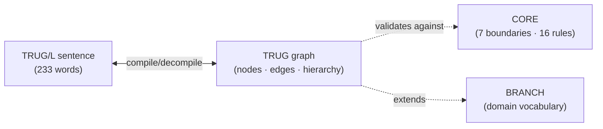

# TRUGS — Traceable Recursive Universal Graph Specification

[](LICENSE)
[](https://github.com/TRUGS-LLC/TRUGS/actions/workflows/compliance.yml)
[](https://doi.org/10.5281/zenodo.19379454)

**Maintained by:** TRUGS LLC

## What is TRUGS?

TRUGS is a JSON graph specification for representing structured information. A TRUG is a JSON file with three components:

1. **Nodes** — typed things (functions, pages, chapters, tasks, parties)
2. **Edges** — named relationships between things (feeds, governs, depends_on)
3. **Hierarchy** — organization via parent/child containment using metric levels

**CORE + BRANCH = Complete TRUG.** CORE defines the universal structure every TRUG must satisfy. BRANCHES define domain-specific vocabularies.



The sentence IS the program. The graph IS the AST. Every valid TRUG/L sentence compiles to a graph losslessly, and every graph decompiles back to a sentence.

## Four types of TRUGS

### Describe

Describe builds a graph from sources so that their entities and relationships can be queried. [TRUGS-WEB](https://github.com/TRUGS-LLC/TRUGS-WEB), available as [trugs-web 2.1.0](https://pypi.org/project/trugs-web/), builds a TRUGS graph from web sources or local folders and queries it. [TRUGS-VIEWER](https://github.com/TRUGS-LLC/TRUGS-VIEWER) is a live demonstration.

### Instruct

Instruct states what must be done: a sentence in TRUG/L, the language of this specification, compiles to a graph, which is validated. [trugs-tools 2.4.0](https://pypi.org/project/trugs-tools/) compiles and decompiles the [specification's examples](TRUGS_LANGUAGE/SPEC_examples.md) with `trug trl`; TRUGS-TRL and TRUGS-LAW are coming.

### Compute

Compute represents calculations as graphs. [TRUGS-ACCOUNTING-CALCULATOR](https://github.com/TRUGS-LLC/TRUGS-ACCOUNTING-CALCULATOR) is a public accounting calculator repository in which every calculation is a TRUGS graph.

### Govern

Govern uses a graph to govern how work runs. The runner is coming.

See the [version and compatibility table](COMPATIBILITY.md) for component versions, Python minima and package requirements.

## Install

**The specification is this repository.** Read the Markdown specs and `.trug.json` files here directly — there is nothing to install to get the spec.

The 2.0.0 spec revision adds 21 SI level prefixes (YOTTA…YOCTO) as a new part of speech for hierarchy transition markers — see [SPEC_vocabulary.md §9](TRUGS_LANGUAGE/SPEC_vocabulary.md#9-level-prefixes--hierarchy-transition-markers-21).

For the `trug` CLI and all tooling, install the sibling package:

```bash
pip install trugs-tools    # provides the `trug` binary — 8 language verbs
trug --help
```

See [TRUGS-LLC/TRUGS-TOOLS](https://github.com/TRUGS-LLC/TRUGS-TOOLS) for the `trug` CLI — validation, TRL compile/decompile, graph CRUD, and Dark Code compliance.

## TRUGS Language

TRUGS includes a formalized subset of English — 233 words drawn from computation, law, and SI prefixes — where every valid sentence compiles to a TRUG graph and every graph decompiles back to a sentence. Losslessly.

```
<trl>
PARTY system SHALL FILTER ALL ACTIVE RECORD
  THEN SORT RESULT
  THEN WRITE RESULT TO ENDPOINT output
  OR RETRY BOUNDED 3 WITHIN 60s.
</trl>
```

Every word is from the vocabulary. The sentence IS the program. The graph IS the AST.

See [TRUGS_LANGUAGE/](TRUGS_LANGUAGE/) for the complete specification.

## Specification

| Document | Description |
|----------|-------------|
| [CORE.md](TRUGS_PROTOCOL/CORE.md) | 7 boundaries, 10 primitive classes (~131 primitives), 16 validation rules, composition type system |
| [BRANCHES.md](TRUGS_PROTOCOL/BRANCHES.md) | Domain-specific vocabularies (Code, Web, Writer, Knowledge, etc.) |
| [SPEC_fundamentals.md](TRUGS_PROTOCOL/SPEC_fundamentals.md) | Core concepts and structure |
| [SPEC_validation.md](TRUGS_PROTOCOL/SPEC_validation.md) | Validation rules with implementations |
| [SCHEMA.md](TRUGS_PROTOCOL/SCHEMA.md) | JSON schema reference |

## Language

| Document | Description |
|----------|-------------|
| [SPEC_vocabulary.md](TRUGS_LANGUAGE/SPEC_vocabulary.md) | 233 words, 9 parts of speech, formal definitions |
| [SPEC_grammar.md](TRUGS_LANGUAGE/SPEC_grammar.md) | BNF grammar, composition rules, 12 validation rules |
| [SPEC_examples.md](TRUGS_LANGUAGE/SPEC_examples.md) | 30 parsed examples across 13 patterns |
| [language.trug.json](TRUGS_LANGUAGE/language.trug.json) | The opening TRUG — the language defining itself |

## Tools — via `trugs-tools`

The graph operations below use the `trug` CLI from the sibling [`trugs-tools`](https://github.com/TRUGS-LLC/TRUGS-TOOLS) package (`pip install trugs-tools`) — 8 language verbs.

| Verb | Usage | Description |
|------|-------|-------------|
| `trug validate` | `trug validate <file>` | Enforces all 16 CORE rules |
| `trug validate` | `trug validate --all <dir>` | Batch validation |
| `trug get` | `trug get <file> <node_id>` | Read a node |
| `trug update` | `trug update <file> <node_id> --set key=value` | Update a node |
| `trug delete` | `trug delete <file> <node_id>` | Delete a node and its edges |
| `trug unlink` | `trug unlink <file> --from X --to Y` | Remove an edge |

Run `trug --help` for the command surface; see the [trugs-tools repository](https://github.com/TRUGS-LLC/TRUGS-TOOLS) for the tooling.

## Examples

The [EXAMPLES/](EXAMPLES/) directory contains sample TRUGs for 7 domains at varying complexity levels. All 7 examples pass validation.

## This repo, as a TRUG

This repository describes itself as a TRUG. [`folder.trug.json`](folder.trug.json) at the repo root indexes selected folders, documents and tool files, with typed edges to the specs and standards they implement or describe. It omits `.github`; the builder's file-level node contains individual nodes for its public functions.

```bash
# Validate the repository's graph
trug validate folder.trug.json

# What does the language-graph builder implement (and what tests it)?
trug get folder.trug.json tools_build_language_trug --edges

# Check Dark Code compliance
trug compliance .
```

For pushes to `main` and pull requests targeting `main`, CI runs `make check` (secrets, formatting, lint, types, tests, shipped-graph validation via `trug validate`, the deterministic vocabulary rebuild, and `trug audit markdown`) in [.github/workflows/check.yml](.github/workflows/check.yml); [.github/workflows/compliance.yml](.github/workflows/compliance.yml) runs `trug compliance .` and `pytest tools/test_build_language_trug.py -v` in separate jobs.

## Use It

Start with the [language specification](TRUGS_LANGUAGE/) and [example graphs](EXAMPLES/). [TRUGS-AGENT](https://github.com/TRUGS-LLC/TRUGS-AGENT) is available as the onboarding kit for AI agents.

## Building on TRUGS

**CORE and Language** are maintained by TRUGS LLC. The 233-word vocabulary, grammar, and validation rules are the specification — they don't change without a spec revision.

**Branches** are where the community builds. If your domain needs vocabulary that doesn't exist (medical, financial, legal, robotics, etc.), build a branch:

1. Define your domain's node types and edge relations
2. Use CORE primitives as your foundation
3. Add domain-specific words to your opening TRUG
4. Validate your TRUGs against CORE

You don't need permission. Build it, use it, share it. Once enough people are using a branch in the same domain, we'll work with the community to formalize it into the specification.

**Implementations** are welcome. Build tools that read, write, validate, or execute TRUGs in any language. The spec is the contract — implement it however you want.

## Scope

This software does not include self-modifying TRUGS: graphs that change their
own structure while they run.

## License

The TRUGS specification and reference tools are released under the [Apache License 2.0](LICENSE). Anyone may implement the standard.
